# Kairos — Farm-level extreme-weather alerts and advisories

EU Agri Hackathon 2026 · Team 20 · *Compost Compilers*

Kairos tells a grower, in plain words, **which of their plots is at risk from extreme weather, why, and what to do about it**. An agronomist stays in the loop: every alert can be validated, edited or held off before the grower acts on it.

**Olive in Spain is the prototype crop.** The design is crop-agnostic: a crop is a decision table, a feature map and a stage calendar under `configs/crops/<crop>/`. Regions covered by the configs: Andalucía, Castilla-La Mancha, Extremadura, Cataluña and Comunitat Valenciana.

> **Status: working hackathon prototype, not a production service.** Weather is a replay of real 2025 ERA5 data, not a live forecast. Thresholds come from literature and are **not yet validated by an agronomist**. Grower, farm and plot names are demo data. See [Limits](#limits-read-this-before-trusting-an-alert).

## What it does

```
LPIS plots ──┐
ERA5 weather ├─► features per plot / province ─► decision-table rule engine ─► alerts + advice
RAIF reports ┘                                          ▲                          │
                                                        │  validate / edit /       ▼
                                        agronomist reviews ◄──── advisor ◄── farmer app
                                                        ▲
                                    local LLM (RAG) explains alerts, never decides them
```

1. **Data.** Real plot geometry from the Spanish LPIS (SIGPAC), and hourly ERA5 / ERA5-Land weather from Copernicus. Weather is aggregated per plot cell and, weighted by olive area, per province.
2. **Rule engine** (`src/kairos/rules/table_engine.py`). A 142-row literature decision table (stage, hazard, variable, threshold, action, lead time, source URL, confidence). 46 rows can be evaluated from daily weather. The other 96 need field observations and are listed with the reason, never silently dropped. The engine knows the crop stage from an approximate calendar.
3. **Advice.** Each firing rule becomes a farmer-friendly alert with a headline, steps, lead time, evidence and source. Kairos adds two demo water rules (soil drying, rain ahead) that are marked low-confidence.
4. **Agronomist validation.** Agronomists approve, change or reject each scenario (Flask tool), and advisors validate individual alerts (dashboard and phone app). Decisions are read by the rule engine immediately: approved → validated, changed → new threshold and action, rejected → stops firing.
5. **Assistant (RAG, local LLM).** A small Ollama model explains alerts to growers ("Ask Kairos") and explains to advisors why the system triggered. It only sees the retrieved decision-table rows and the alert, any number it writes must appear in that context, and it falls back to the standard advice if the model is off. **It never creates, cancels or changes an alert.** Advisors rate its answers, and good or corrected answers are fed back as examples.
6. **Back-test** against RAIF (Andalucía field reports), 2025. Honest results in [docs/backtest-2025.md](docs/backtest-2025.md).

## The demo: three surfaces, one command

| Surface | URL | For | What it shows |
|---|---|---|---|
| Farmer app (iPhone style) | http://localhost:8000/farmer/ | Growers | Alerts, advice, "why Kairos says this", **Ask Elena to check this**, **Ask Kairos** (AI), report a problem, parcels, chat |
| Advisor app (iPhone style) | http://localhost:8000/advisor/ | Advisors on the move | Your farmers, requests, field reports, validate / edit / hold off, **explain why it triggered** (AI) |
| Advisor dashboard (Streamlit) | http://localhost:8501 | Advisors at a desk | Satellite map of LPIS plots, rule-engine actions per plot, weather time series per plot, batch validate, **AI answers** review tab |
| Agronomist review (Flask) | http://localhost:5050 | Agronomists | Plain-language list of the 142 scenarios, decide on each, **interactive crop-level figures** (draggable threshold, sensitivity curve, month × province heatmap, RAIF overlay), CSV export |
| API docs | http://localhost:8000/docs | Developers | All endpoints |

The surfaces share one state, so a request from the farmer app shows up in the advisor app within seconds, and a validation returns to the farmer as "Checked by advisor". A verified field report anonymously warns growers within 10 km.

### Screenshots

Taken from the running demo on the 2025 replay (24 October for most screens). Names and the irrigation log are demo data; plots and weather are real.

**Farmer app** — alerts, advice with the reasons behind it, "Ask Kairos" (AI explanation), parcels, report a problem

<table><tr>
<td>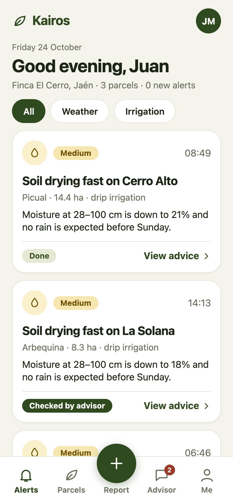</td>
<td>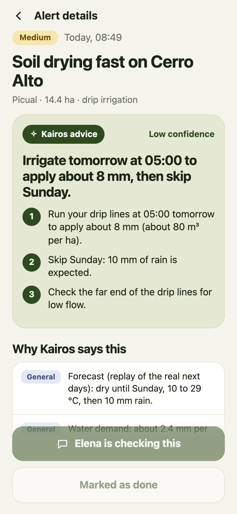</td>
<td>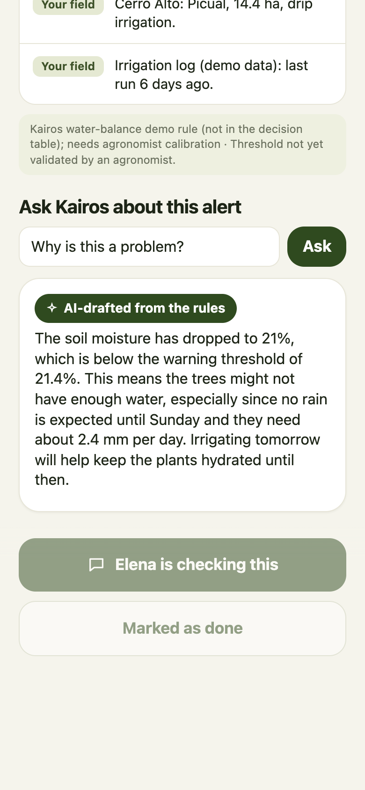</td>
<td>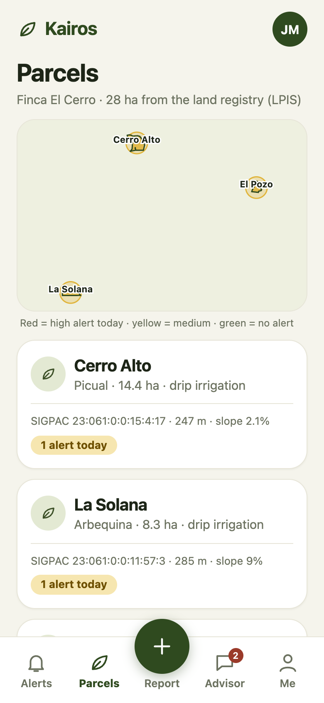</td>
<td>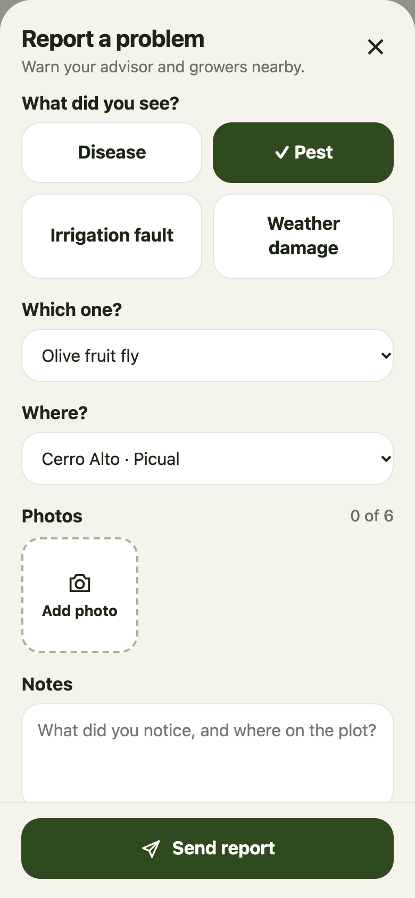</td>
</tr></table>

**Advisor app** — your farmers, requests, validate / edit / hold off, "explain why the system triggered this"

<table><tr>
<td>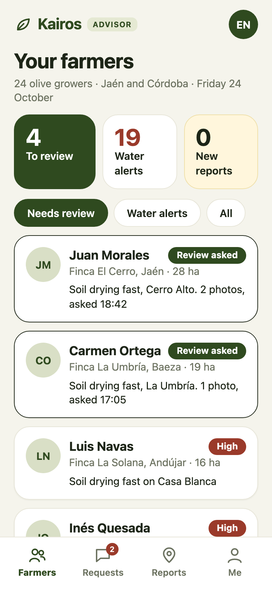</td>
<td>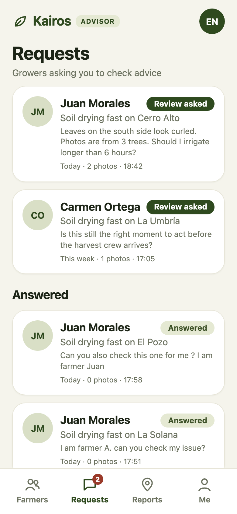</td>
<td>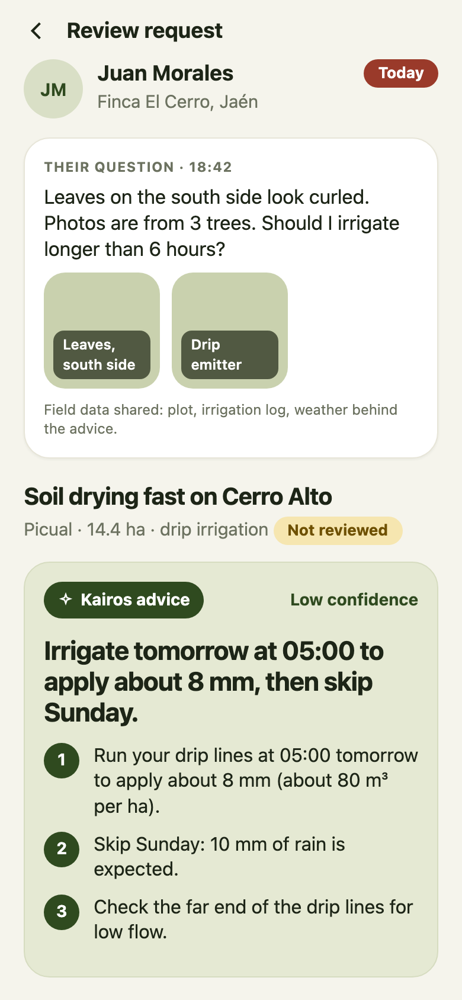</td>
<td>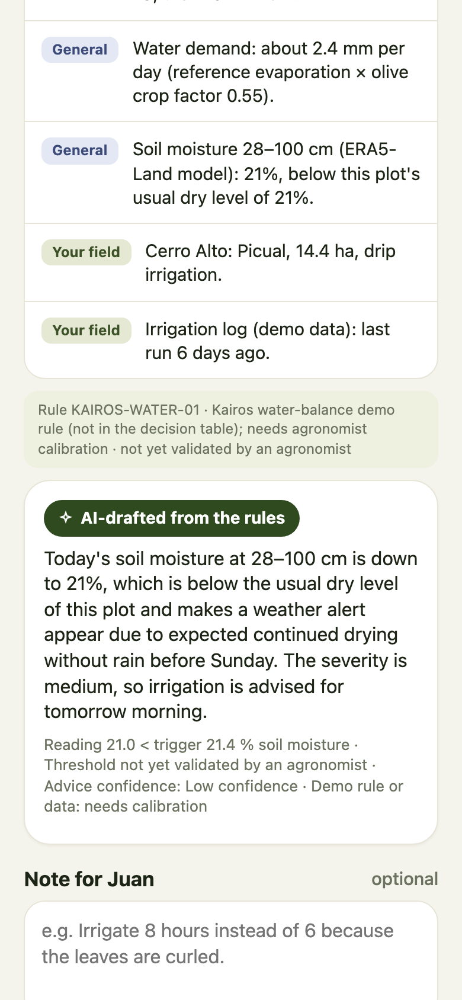</td>
</tr></table>

**Advisor dashboard (Streamlit)** — satellite map of the LPIS plots coloured by alert severity, rule-engine actions per plot, validation

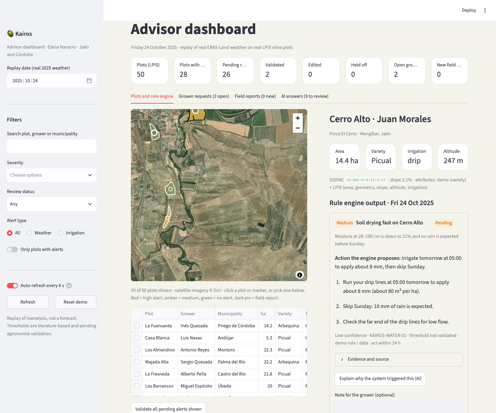

Weather time series for the selected plot (temperature, rain, soil moisture, humidity, wind, degree-days):

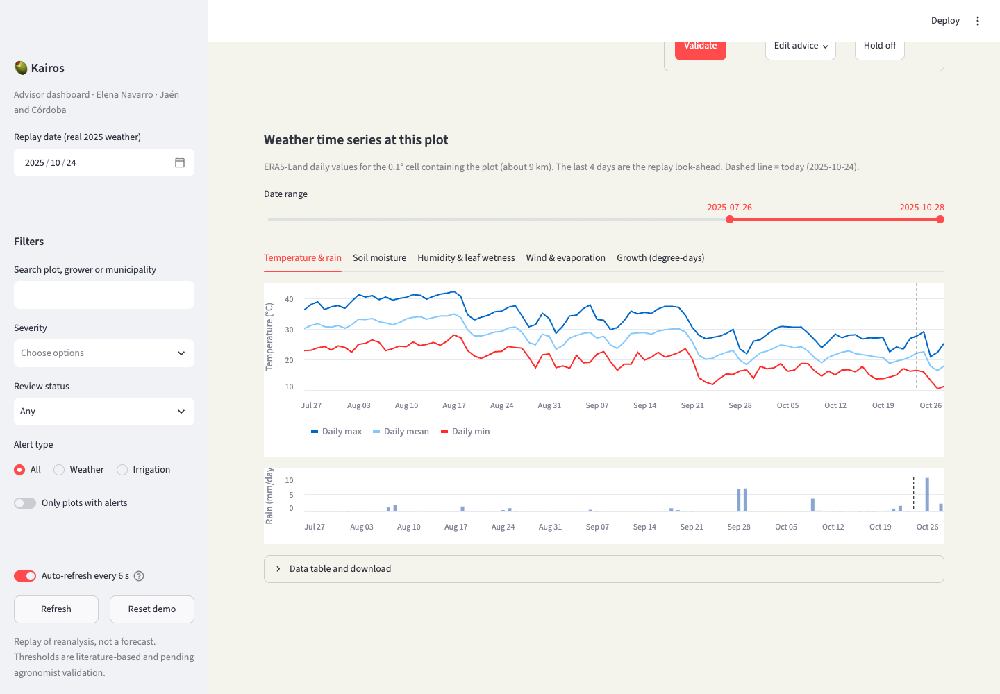

**Agronomist review (Flask)** — one scenario with the live threshold test, and the crop overview

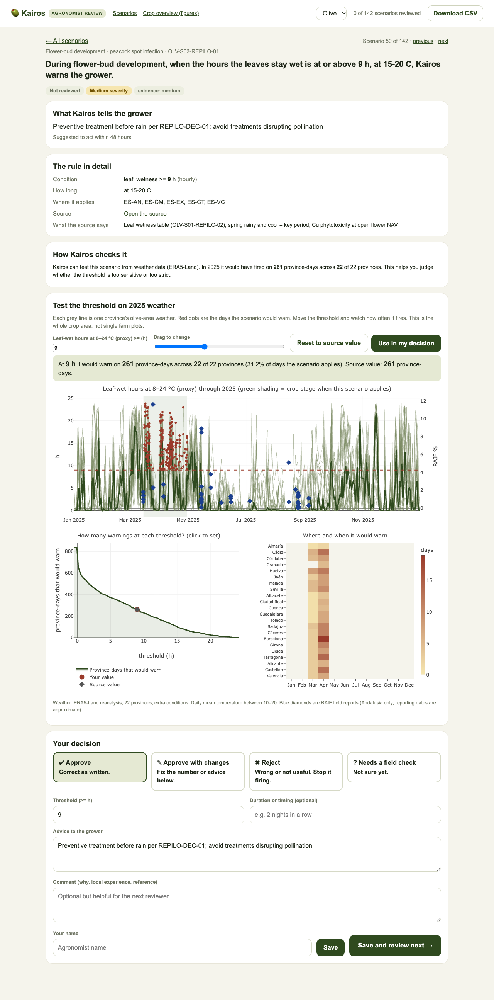

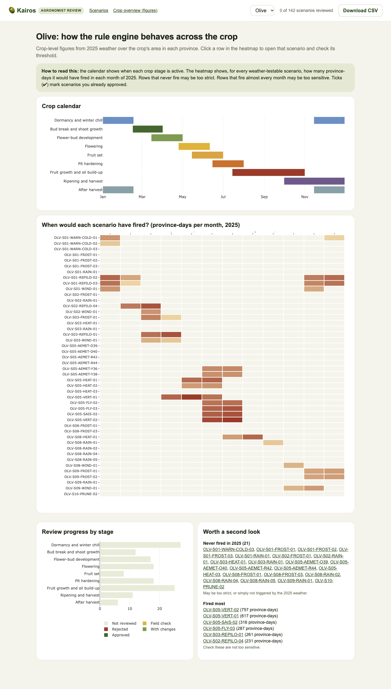

### Real vs demo data
- **Real:** plot shapes, areas, SIGPAC references, slope, altitude and irrigation coefficient (LPIS); 2025 ERA5-Land weather per plot cell; decision-table rules and sources; RAIF observations.
- **Demo:** grower, farm and plot names, varieties (unless you join your own olive dataset), the irrigation log and water-use alert, seeded requests and reports, and "tomorrow / forecast", which are the actual following days of 2025.

## What you need

| Need | For | Notes |
|---|---|---|
| **Python 3.12+** and **[uv](https://docs.astral.sh/uv/)** | everything | `uv sync` creates the environment and installs all Python dependencies (FastAPI, pandas, xarray, geopandas, Streamlit, Flask, cdsapi, …) |
| **[Ollama](https://ollama.com)** + `ollama pull qwen2.5:3b` | AI answers (optional) | about 2 GB download, runs on the local GPU or CPU. Without it, the apps still work and show the standard advice. Override the model with `KAIROS_LLM` |
| **Copernicus CDS account** | downloading ERA5 | free; put your key in `~/.cdsapirc` ([instructions](https://cds.climate.copernicus.eu/how-to-api)) and accept the dataset licences |
| **Chrome / Safari** | viewing | the agronomist figures load Plotly from a CDN, so they need internet |
| Node 20+ | only `web/` | an unused React stub; not needed for the demo |

The repository does **not** contain data (`data/` is gitignored). To see the demo you must build the demo data once (below). It needs the LPIS files for Jaén and Córdoba and the 2025 ERA5 files.

## Install

```bash
git clone https://github.com/tobyzawthuhtet/compost-compilers-eu-agri-hackathon-2026.git kairos
cd kairos
uv sync                      # Python dependencies
cp .env.example .env         # optional keys (CDS, Sentinel Hub, AEMET); the demo itself needs none
ollama pull qwen2.5:3b       # optional, for the AI assistant
```

## Build the data (once)

Run in this order. Each step is re-runnable, and downloads skip files already present.

```bash
# 1. Plots: Spanish LPIS (SIGPAC) from the FEGA service. Large: restrict regions to save time/space.
uv run python scripts/download_lpis.py --regions andalucia

# 2. Olive area per weather grid cell and province
uv run python scripts/build_olive_weights.py

# 3. Weather: ERA5 / ERA5-Land for 2025 (needs ~/.cdsapirc; requests queue at Copernicus and can take hours)
uv run python scripts/download_era5.py --start 2025-01 --end 2025-12

# 4. Daily olive-weighted features per province
uv run python scripts/build_features.py --regions andalucia

# 5. (optional) RAIF field reports for the back-test: put the RAIF olive PDFs in data/raw/ground_truth/raif/ first
uv run python scripts/extract_raif.py
uv run python scripts/backtest_raif.py        # also: make backtest

# 6. Demo growers and plots from real Jaén and Córdoba parcels
uv run python scripts/build_demo_farms.py
```

The decision table (`configs/crops/olive/decision_table.csv`) is committed. To regenerate it from the per-stage scenario sheets: `uv run python scripts/build_decision_table.py olive`.

**Bring your own olive dataset.** Drop CSVs in `data/raw/olive_dataset/` with a `sigpac_ref` column (`province:municipality:aggregate:zone:polygon:parcel:enclosure`) plus any of `variety, irrigation, planting_year, tree_density, yield_kg_ha`, then re-run step 6. The values replace the demo ones.

## Run

```bash
make demo-up      # starts everything and prints the URLs, including your Wi-Fi address for an iPhone
make demo-down    # stops everything and unloads the language model
```

`make demo-up` starts the API with the farmer and advisor apps (port 8000), Streamlit (8501) and the Flask agronomist tool (5050), and loads the model if Ollama is installed. If a port is busy, it says so. Run `make demo-down` first.

**Suggested walkthrough**
1. Open the farmer app (`/farmer/`), tap an alert → **View advice** → **Ask Elena to check this**.
2. Open the advisor app (`/advisor/`) → **Requests** → validate, edit or hold off. Go back to the farmer app and see "Checked by advisor".
3. In the farmer app, ask Kairos a question on the alert page. In the advisor app, tap **Explain why the system triggered this**.
4. Open the dashboard (`:8501`): satellite map, per-plot weather series, **AI answers** tab to rate the assistant.
5. Open the agronomist tool (`:5050`): pick a scenario, drag the threshold on the figures, **Use in my decision**, then watch the apps pick up the change.
6. Use the date box (Me tab or dashboard) to move the replay day.

On an iPhone on the same Wi-Fi, open the printed address in Safari, then Share → Add to Home Screen for a full-screen app. More detail in [docs/demo.md](docs/demo.md).

## Develop

```bash
make test        # pytest (32 tests)
make lint        # ruff
make api         # API only, with reload: http://localhost:8000/docs
uv run python scripts/eval_assist.py   # check the assistant on golden questions (needs Ollama)
```

Repository layout:

| Path | What |
|---|---|
| `src/kairos/rules/` | decision-table engine, agronomist reviews |
| `src/kairos/features/` | ERA5 → daily features |
| `src/kairos/serving/replay.py` | 2025 replay, alerts table, back-test access |
| `src/kairos/demo/` | demo core: farms, alerts, requests, reports, shared state |
| `src/kairos/assist/` | RAG assistant: corpus, retrieval, Ollama client, answer checks, advisor feedback |
| `src/kairos/api/` | FastAPI app and `/demo/*` routes |
| `demo/` | farmer app, advisor app, shared CSS/JS, Streamlit dashboard |
| `agronomist/` | Flask scenario-review tool and interactive figures |
| `configs/` | crops (decision table, feature map, stage calendar, water rules), provinces, municipalities |
| `scripts/` | data download and build, back-test, demo launcher |
| `docs/` | architecture, data sources, back-test, demo guide, scenario sheets |
| `web/` | React + Vite stub, not used by the demo |

## Back-test summary (RAIF 2025, Andalucía)

| Test | Result |
|---|---|
| Full-flowering date from degree-days | Fails as configured: 1 of 3 provinces within ±15 days |
| Peacock spot vs wet hours | Moderate positive signal (Spearman ≈ 0.54, n = 26, p ≈ 0.005); may partly be season |
| Olive fly vs hot days | Not distinguishable from noise (n = 14) |

No threshold was tuned on this data. Frost, hail and wind have no labels, so they cannot be scored. Details and next steps: [docs/backtest-2025.md](docs/backtest-2025.md).

## Limits: read this before trusting an alert
- Weather is a **2025 replay** (ERA5 reanalysis), not a live forecast. A live source (for example AEMET or a numerical forecast) is the first production step.
- Thresholds are **literature-based and unvalidated**. The apps label unvalidated rules, and the two Kairos water rules are demo-only and fire on many plots until an agronomist calibrates them.
- The crop-stage calendar is approximate. Only 46 of 142 scenarios can be evaluated from weather. Hourly rules use the daily extreme.
- Back-test is one year and mostly Jaén. It is a sanity check, not validation.
- The AI assistant is a 3B local model. It explains, it does not decide, but it can still be vague or wrong. Its answers are labelled "AI-drafted", numbers are checked against the rules, and advisors can rate or correct them.
- Only olive has weather series so far. Other crops need a decision table, an area mask and features.
- The SIAR station network is out of scope. Jaén city and Córdoba city LPIS files are missing from the plot data.

## More documentation
[docs/architecture.md](docs/architecture.md) · [docs/data-sources.md](docs/data-sources.md) · [docs/decision-rules.md](docs/decision-rules.md) · [docs/data-requirements.md](docs/data-requirements.md) · [docs/ground-truth-datasets.md](docs/ground-truth-datasets.md) · [docs/backtest-2025.md](docs/backtest-2025.md) · [docs/demo.md](docs/demo.md)
